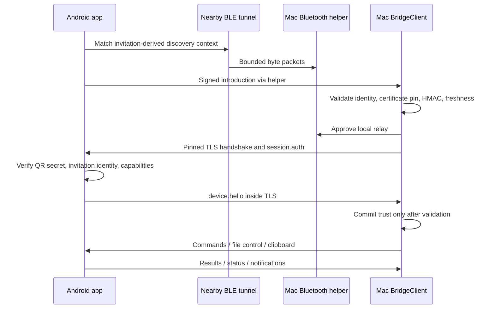

# Architecture

Twinvia has two native applications and a small isolated Mac transport process. The shared contract has no dependency on the application layers. Kotlin uses the JVM/JCA and serialization; Swift uses Foundation/CryptoKit.

## Data and trust flow

The relay forwards ciphertext without terminating TLS. Nearby-level connection acceptance is not application authentication. The helper owns discovery and the local tunnel; the Mac application owns trust, TLS, and application events. Android admits only the exact loopback socket created by its tunnel before processing a TLS session.

## Code map and responsibilities

| Area | Responsibility |
| --- | --- |
| Android `TwinviaApplication` | Composition root; creates identity, notifications, and bridge. |
| Android `core/connection/BridgeRepository` | Coordinates session lifetime, bounded consumers, feature adapters, and reactive state. |
| Android `PeerLink` / `NearbyBleLink` | Transport contract / Google Nearby adapter. Does not decide persistent application trust. |
| Android `SessionAuthenticator` | Pure validation of pending/saved trust, protocol version, peer identity, shared secret, and capability bounds. |
| Android `CommandProcessor` / `CommandHandler` | Pure validation, bounded duplicate-result history, and error isolation / injected platform effects. The single command consumer owns history. |
| Android `DeviceCommandHandler` | Dispatches validated actions to OS adapters and rechecks session ownership across dispatcher changes. |
| Android `features/*` | OS-specific clipboard, notifications, contacts, storage, media, calls, remote-screen session, and Compose UI. |
| Mac `App/` | Application lifecycle and composition of feature controllers. |
| Mac `Connection/BridgeClient` | TLS/session orchestration and typed event delivery. Transport creation is injected through `PeerLink`. |
| Mac `Connection/BridgeEvent` | Decodes valid envelopes into typed events. Unknown application events fail closed. |
| Mac `Connection/PeerTrustStore` | Narrow persistence contract with a Keychain adapter; startup loading and transport creation can be substituted in tests. |
| Mac `Connection/HelperEventStream` | Bounded JSON-line parsing for fragmented or coalesced helper events. |
| Mac `Connection/MessageReplayWindow` | Bounded duplicate-ID receipt history, separate from notification-content suppression. |
| Mac `Features/*` | Feature state and OS integrations, grouped by clipboard, files, notifications, phone data, calls, and device controls. |
| Mac `UI/*` | SwiftUI presentation; it does not own socket or trust logic. |
| Mac `BluetoothBridge` | Isolated Google Nearby SDK process, ordinary Bluetooth permissions, bounded stop-and-wait relay. |
| Shared `WireFrame` | Four-byte network-order framing, size validation before allocation/write. Same byte contract in both languages. |

## Design rules

- **Single responsibility:** transport, session authentication, command policy, codecs, storage, and presentation have explicit boundaries. Session coordinators compose those pieces rather than reimplementing their rules.
- **Dependency direction:** application features depend on the protocol; the protocol never imports Android, AppKit, SwiftUI, or application classes. Platform effects are behind narrow transport/command contracts where substitution is useful.
- **Substitution and interface size:** `PeerLink` exposes discovery/tunnel lifecycle only. Test doubles obey the same lifecycle without starting Bluetooth or a real helper. `CommandHandler` supplies effects without making policy depend on Android services.
- **Open extension points:** add commands through their validated schema, platform adapter, and tests. Add a transport by implementing its contract and preserving the existing trust boundary. Do not bypass policy inside UI code.
- **No abstraction for its own sake:** simple feature controllers remain concrete. SOLID does not require a wrapper or interface around every value or OS call.

## Lifetimes and concurrency

Mac application state is MainActor-owned. File handles and hashing use their existing actor isolation. Network callbacks hop to the owning actor and compare generation identifiers so callbacks from replaced sessions cannot mutate a new one. Shutdown invalidates pending trust reads before stopping the transport.

Android uses an IO supervisor scope, a bounded command channel (8), a bounded file channel (4), and a small bounded handshake admission pool. Only the current authenticated socket may dispatch queued work. Main-thread platform actions recheck session identity after switching dispatchers. Coroutine cancellation is propagated; malformed commands return bounded errors and do not terminate the command consumer.

The command cache is capped at 128 entries. Read/list/download, audio-control, and remote-screen commands bypass it so permissions and current state are checked again. Side-effect duplicates can reuse a completed result. Request timestamps are validated before cached results are returned. This cache is not an exactly-once guarantee across application restarts.

## Feature safety boundaries

- File transfer requires receiver approval, limits chunks and total size, verifies SHA-256, and keeps incomplete output separate. Filenames and shared-storage paths are validated; private app storage is outside the browser.
- Clipboard pauses on device lock/disconnect. Incoming Mac text/image writes use the ordinary Android ClipboardManager; the optional shell helper only reads phone copies made in other apps. Text echo suppression and image acknowledgements prevent loops and false completion. Image deadlines account for BLE transfer time.
- Screen viewing requires a short phone-approved lease; touch control requires a second approval. Screenshot data stays in memory, is bounded in size, and is sent only to the authenticated peer. Lock, screen off, disconnect, permission revocation, and lease expiry end control. The screen adapter does not inspect the accessibility UI tree.
- Notification receipt history and delivery state suppress unchanged snapshots and stale banners independently of wire-ID replay handling.
- Calls use explicit tokenized actions. BLE does not advertise the experimental PCM audio capability.

See [transport details](ble-transport.md), [screen control](remote-control.md), [testing](testing.md), and [development](development.md).
